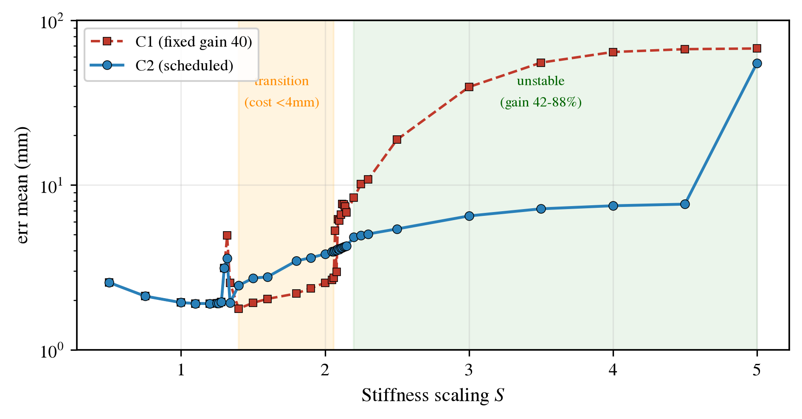

# Condition-Number-Triggered Gain Scheduling for Inverse Kinematics Control of Tendon-Driven Continuum Robots

Code and data for the paper (revised manuscript, R1). OpenCR-MuJoCo is used as
the evaluation platform (backbone discretized into a rigid-link chain with
elastic joints, tendons actuated by MuJoCo's native tendon model, calibrated
against SoRoSim Cosserat-rod solutions).

> **Scope.** Everything here is simulation: a three-segment TDCR with six
> Clarke-space DOFs and nine tendon actuators tracking a figure-eight, at
> `dt = 0.001 s` with a 50 Hz controller, scored over `t ∈ (10, 20) s`
> (n = 499 steps), with the first 50 steps discarded as a numerical warm-up.
> Gravity is disabled so that stiffness is the only quantity moving the numbers,
> and every run uses the single seed `SEED = 42`, so the tables reproduce
> exactly. Both switching thresholds are fixed on a dense 24-point calibration
> set that excludes every evaluated stiffness level. There is no hardware
> experiment and no repeated-seed statistics.

## TL;DR

C2 reads the Jacobian condition number `cond_J` and, when its 20-step window
mean `cond_slide` runs high, moves the outer gain from 40 down to 20, restoring
it as the conditioning recovers. Both thresholds (`C_up = 160`, `C_down = 70`)
are fixed on a 24-point calibration set (`S = 1.1–4.6`) that excludes every
evaluated stiffness level. Over **S = 2.2–4.5** C2 cuts steady-state error by
**42%–88.5%** at **zero saturation** (Tables 1–2), and at **S = 1.0** it returns
C1's 1.93 mm; the transition costs at most ~1.3 mm on the calibration path
(~2.2 mm at worst across the configurations), with a single misfire at
S = 1.5 costing 0.79 mm. Across **28 configurations and 88 pairs** the frozen
thresholds carry unchanged, and **26 of 28** configurations gain at `S = 2.5`
(Table 3).

## Result figure

<p align="center">
  
</p>

*Figure 3 of the paper: C1 against C2 over the full sweep S = 1.0–5.0.*

## Abstract

Task-space inverse kinematics (IK) for tendon-driven continuum robots (TDCR)
degrades in two respects under high-stiffness contact: tracking error grows and
the actuator command clip engages. The damped least squares (DLS) core is left
as it is, and around it we place an external gain scheduler, C2, driven by the
Jacobian condition number `cond_J`. A 20-step window mean, `cond_slide`, exceeds
`C_up` on a fraction of steps that climbs to 35.41% at S = 2.5 and eases to
25.61% at S = 3.0, monotone up to 2.5; `cond_slide` stays usable as an online
flag across that monotone stretch. When `cond_slide` runs high, C2 moves the
outer gain from 40 down to 20 as the conditioning degrades. Over S = 2.2–4.5,
C2 cuts error by 42%–88.5% at zero saturation, while at S = 1.0 C2 keeps C1's
1.93 mm (transition ≤ ~1.3 mm on the calibration path). The envelope defended
here stops at S ≤ 4.5. At S = 5.0 the actuators saturate for physical reasons
and `cond_slide` can no longer distinguish gain mismatch from saturation. Both
thresholds are fixed on a dense 24-point calibration set that excludes every
evaluated stiffness level. Across twenty-eight configurations and eighty-eight
pairs, sixty-three of them on configurations outside the calibration path and
the remaining twenty-five variants of it, the thresholds carry unchanged and
twenty-six of twenty-eight configurations gain at S = 2.5. All results are
obtained in simulation on OpenCR-MuJoCo; re-validation of the thresholds and
hardware trials remain future work.

**Keywords:** tendon-driven continuum robot; inverse kinematics; damped least
squares; gain scheduling; Jacobian condition number; variable stiffness
(identical to the paper's Index Terms).

## Method

- **C1 (baseline):** fixed-gain (`G = 40`) task-space IK controller over an
  unchanged DLS core (`λ = 0.05`, clip `v_max = 1.0`); it degrades at high
  stiffness, reaching 18.86 mm error and 23.85% saturation at S = 2.5.
- **Threshold derivation (II-B):** both thresholds are fixed on a calibration
  set that excludes every stiffness level later used for evaluation. The set
  spans S = 1.1–4.6 with denser coverage between S = 2 and 3 (24 points). The
  healthy ceiling is the 95th percentile of the 20-step mean `cond_slide` over
  the calibration points up to S = 1.4 (153.0 at S = 1.32); the degraded floor
  is the 5th percentile over the points from S = 2.25 upward (76.0 at
  S = 2.25). `C_up = 160` clears the healthy ceiling by 7.0 and `C_down = 70`
  sits 6.0 below the degraded floor; the 1.6–2.15 transition points are shown
  but enter neither threshold. The evaluation levels
  S ∈ {1.0, 1.5, 2.2, 2.5, 3.0, 4.0, 4.5, 5.0} are held out from this
  derivation and enter only the evaluation tables.
- **Observation:** the trigger ratio — the fraction of scored steps on which
  the 20-step window mean `cond_slide` exceeds `C_up = 160` — reads 0% at
  S = 1.0 and 1.5, rises to 28.06% at S = 2.2, peaks at 35.41% at S = 2.5 and
  eases back to 25.61% at S = 3.0. Growth stays monotone up to S ≤ 2.5, which
  is what makes `cond_slide` usable as an online flag.
- **C2:** lowers the gain (40 → 20) when `cond_slide` is high and restores it
  when low, with hysteresis band `C_up = 160` / `C_down = 70` and asymmetric
  ramping (−4.0 per step over 5 steps down, +0.4 per step over 50 steps up).
  Nothing inside the DLS solver is modified.
- **Results:** at S = 2.2 error drops 8.37 → 4.82 mm (42.4%); at S = 2.5,
  18.86 → 5.41 mm (71.3%); at S = 3.0, 39.40 → 6.49 mm (83.5%); at S = 4.5,
  66.87 → 7.66 mm (88.5%). C2 saturation stays at 0% for every S ≤ 4.5 (not
  "throughout": at S = 5.0 C2 reaches 54.95 mm with 39.08% saturation, where
  the plant itself is clipped and the algorithm is out of its controllable
  range).
- **Generalization (III-C):** twenty-eight configurations — eight on the
  calibration path and its variants (curvature direction, aspect, scale), four
  held-out paths, four workspace shifts, and twelve with contact, indentation
  load (2/4/6 mm) or tendon change — run at up to four stiffness levels, giving
  eighty-eight pairs, sixty-three of them outside the calibration path. With
  the thresholds frozen throughout, twenty-six of twenty-eight configurations
  gain at S = 2.5 (31%–85.7%); the two that do not (85% tendon allocation,
  −5.6%; −z workspace shift, 0.0%) barely clip under C1 (1.4% and 0.0%
  saturation). Against the fixed gain on a separate 60 mm circle as noise rises
  to σ = 5 mm, C1 stays saturated at 26–43 mm while C2 creeps from 5.8 to
  12.1 mm without chatter.

## Quick start (reproducing the paper)

> **Runtime note:** the scripts resolve paths relative to their own locations
> and run in any Linux environment. On Windows, keep the repository at a path
> without non-ASCII characters.

```bash
pip install -r requirements.txt

python 脚本包/28评估脚本/表1.py                  # Table 1  (S = 1.0/1.5/2.2/2.5/3.0)
python 脚本包/控制器阈值论证脚本.py               # Figure 1 (threshold-margin plot)
python 脚本包/28评估脚本/C2泛化_圆形噪声.py       # circle-path + noise check of III-C (data)
python 脚本包/28评估脚本/C2泛化_圆形噪声_画图.py  # circle-path + noise check of III-C (plot)
python 脚本包/全扫描/plot_all.py                 # overview panels used to cross-check Figs. 2/3
```

## Reproducing the paper

| Item | Content | Command / artefact |
|---|---|---|
| Table 1 | Core table, S = 1.0/1.5/2.2/2.5/3.0: trigger ratio, C1 / Fix20 / C2 error and saturation | `python 脚本包/28评估脚本/表1.py` (prints table + LaTeX, writes `数据集/28/analysis/table1_final.csv`) |
| Table 2 | Extension of Table 1 into the saturated regime, S = 4.0–5.0: C1 vs C2 error, saturation, and relative reduction | No dedicated script is shipped. Recompute from `数据集/C1/刚度扫描_8字` and `数据集/C2/刚度扫描_8字` with the same convention as `表1.py` (20-step window mean, first 50 steps discarded as warm-up, `err_true.mean()`, `sat_flag.mean()`). Reference values: `paper_figs/tables/T12_c2_S_sweep.csv`, `数据集/28/analysis/` |
| Table 3 | Per-axis performance across the twenty-eight configurations at S = 2.5: configs, pairs over all levels, Δ range of C2 over C1, C1 saturation | Derived table: `数据集/28/analysis/table3_config_axes.csv`; full 88-pair list: `数据集/28/analysis/all_pairs.csv`. Aggregated by `python 脚本包/28构型泛化/_build_pairs.py` (+ `_ingest_ws2.py`) |
| Figure 1 | Percentile margins of the 20-step mean `cond_slide` on the dense 24-point calibration set used to set `C_up` / `C_down` (evaluation levels excluded) | `python 脚本包/控制器阈值论证脚本.py` → `paper_figs/fig3_threshold.pdf` / `.png` |
| Figure 2 | C1 stiffness sweep: mean error vs S, with the transition band and the degraded region shaded | Pre-rendered: `paper_figs/fig1_S_err.png` (plotting script not shipped) |
| Figure 3 | C1 vs C2 over the full sweep S = 1.0–5.0 | Pre-rendered: `paper_figs/fig2_C1_vs_C2.png` (plotting script not shipped) |
| Figure 4 | All eighty-eight configuration/stiffness pairs; x: sustained saturation ratio of C1 (log scale), y: error reduction of C2 over C1, hollow: no gain, colour: κ95 above/below 160 | Data + plotting: `脚本包/28构型泛化/_fig_pairs.py` (reads `数据集/28/analysis/all_pairs.csv`); pre-rendered: `paper_figs/fig4_all_pairs.png` |

> Note: the file stems under `paper_figs/` follow the plotting order in which
> the figures were produced, **not** the numbering in the paper.
> `fig3_threshold` is Figure 1, `fig1_S_err` is Figure 2, `fig2_C1_vs_C2` is
> Figure 3 and `fig4_all_pairs` is Figure 4. `fig4_c2_circle_noise.png` is the
> circle-path noise check of §III-C, which the revised manuscript reports in
> text only (data: `数据集/28/analysis/c2_generalize_circle.csv`).
>
> Note: `python 脚本包/全扫描/plot_all.py` produces the overview panels
> `F1_8shape` / `F1_circle` (stiffness and noise panels, C1/C2 curves) used to
> cross-check the data behind Figures 2 and 3.

## Data

- `数据集/`: stiffness and noise sweeps for C1 / C2 / Fix20 as npz files
  (figure-8 and circle trajectories; S from 0.5 to 5.0, several σ levels).
- Table 1 covers S = 1.0/1.5/2.2/2.5/3.0. The extended levels
  S = 3.5/4.0/4.5/5.0 support the boundary analysis (C2 still holds at S ≤ 4.5;
  S = 5.0 is physical saturation clipping).
- **28-configuration study:** `数据集/28/analysis/all_pairs.csv` holds all 88
  pairs (columns: `config`, `S`, `k95` — the per-run 95th-percentile condition
  number of `JJᵀ`, `c1_sat_pct`, `reduction_pct` of C2 over C1, `group`,
  `gain` flag), and `数据集/28/analysis/table3_config_axes.csv` is the paper's
  Table 3 (Geometry / Held-out paths / Workspace / Contact-load-tendon / Total).
  The two switching thresholds were never retuned across these runs.
- **Configuration map:** `脚本包/28构型泛化/fig_configs.png` (vector: `fig_configs.svg`)
  draws all 28 configurations on one sheet — for every panel the blue curve is the
  evaluated path and the grey dashed curve is the calibration figure-eight at the same
  scale, so how far each factor was moved is readable at a glance. Each panel also
  carries its pair count and the Δ(C2−C1) at S = 2.5. A per-configuration list
  (axis, what changed, pairs, responsible script) is `脚本包/28构型泛化/configurations_28.csv`.
- **Scripts for the 28 configurations:** `脚本包/28构型泛化/` holds the
  experiment drivers (`traj_family.py`, `B1_云端运行_精简版.py`, `_exp2b.py`,
  `_run_ws2.py`, `_payload_pen.py`, `_exp_tendon.py`), the aggregation and
  plotting tools, and the raw cloud logs under `logs/`. Its README lists which
  script produces which of the seven groups, the gate criterion
  (κ95 > 160 and C1 saturation ≥ 1%), the four misclassifications out of 88
  pairs, and the reproduction commands.
- Derived tables and figure sources: `数据集/28/analysis/`,
  `paper_figs/tables/`. Figures are written to `paper_figs/`.

## Scope and limitations

- **Simulation only.** No physical robot was used; there is no hardware
  validation. Re-validation of the thresholds on hardware remains future work.
- **Single seed, no error bars.** All reported numbers come from `SEED = 42`
  with n = 499 scored steps per run, so the tables reproduce exactly but carry
  no statistical spread.
- **Gravity is disabled**, so the sweeps isolate stiffness; results under
  gravity are not covered.
- **Thresholds are calibrated and scale-bound.** Both thresholds are fixed on
  a dense 24-point calibration set (S = 1.1–4.6) that excludes every evaluated
  stiffness level; they are calibrated for this robot, this trajectory and
  this clip limit, and a different platform means recalibration.
- **Generalization is measured up to S = 2.5 off the calibration path.** The
  S ≤ 4.5 envelope is defended on the calibration path; the transition costs at
  most ~1.3 mm there and ~2.2 mm at worst across the configurations.
- **The noise check is bounded.** One extra trajectory (circle), one stiffness
  (S = 2.5), one noise model (additive Gaussian). It does not support claims
  about other paths, other stiffnesses, non-Gaussian noise, or S > 4.5.
- **Two gain levels only.** Continuous scheduling, multi-trajectory validation
  and hardware trials are left as future work.

## Dependencies and license

- Python 3.10+, MuJoCo ≥ 3.0 (installed automatically from pip).
- The repository is MIT licensed (see [LICENSE](LICENSE)). The bundled Franka
  assets under `assets/franka_assets/` come from MuJoCo Menagerie and are
  Apache-2.0 (see `assets/franka_assets/LICENSE.md`); that notice must be kept.

## Contributing

Contributions that reproduce or extend the paper's experiments (new stiffness
levels, trajectories, or noise settings) are welcome; please report results
using the Table 1 / Table 2 / Table 3 conventions defined above. See
[.github/CONTRIBUTING.md](.github/CONTRIBUTING.md).
