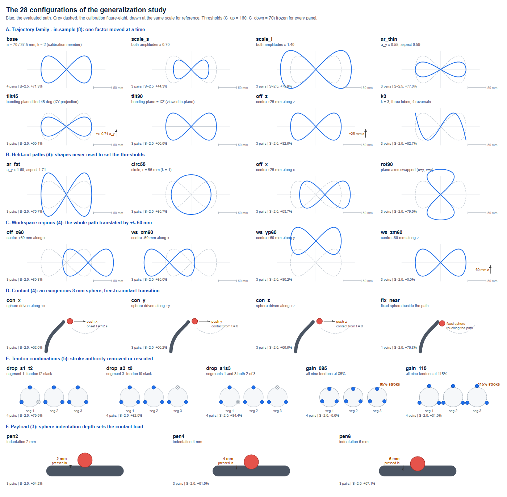

# 28 构型 / 88 对泛化实验脚本包

对应论文 **Section III-C** 与 **Fig. 4 / Table 3**，回应审稿意见：

> "...contact locations and free/contact transitions. The condition-number scheduler should therefore be evaluated across the configuration space rather than along a small number of paths."
>
> "...the thresholds are calibrated on a single figure-eight ... The authors should cover different curvature directions, workspace regions, tendon combinations ..."

## 数据流

```
traj_family.py          ─┐
B1_云端运行_精简版.py     │
_exp2b.py    （接触）     ├─► logs/*.log ──► all_pairs.csv ──► Table 3 / Fig. 4
_run_ws2.py  （工作空间）  │
_payload_pen.py（压入）   │
_exp_tendon.py（肌腱）    ─┘
```

汇总表最终落在 `数据集/28/analysis/all_pairs.csv`（88 行），Table 3 的分轴汇总在
`数据集/28/analysis/table3_config_axes.csv`，Fig. 4 在 `paper_figs/fig4_all_pairs.png`。

## 七组数据（合计 88 对 / 28 构型）

| 组 | 对数 | 脚本 | 日志 | 说明 |
|---|---|---|---|---|
| in-sample | 25 | `traj_family.py` | `_b1_run.log` | 8 构型（base / scale×2 / aspect / tilt×2 / k3 / off_z），3–4 档 |
| held-out | 12 | `B1_云端运行_精简版.py` | `_b1_run.log` | `ar_fat` / `off_x` / `rot90` / `circ55` |
| workspace | 3 | `_exp_contact_ws.py`（v1，废弃） | `_exp2.log` | `off_x60`，无接触，v1 与 v2 等价（见“废弃说明”） |
| workspace2 | 9 | `_run_ws2.py` | `_ws2.log` | 基于 `_exp2b`，`ball=None`，四向 ±60 mm 位移 |
| contact | 10 | `_exp2b.py` | `_exp2b.log` | 三面 + `fix_near`；`fix_off` 有数据但未计入 88 对 |
| loading | 9 | `_payload_pen.py` | `_pen.log` | 压入深度 2 / 4 / 6 mm |
| tendon | 20 | `_exp_tendon.py` | `_exp_tendon.log` | 缺段 ×3 / 85% / 115% |

论文口径的分轴归并：Geometry 8（in-sample）/ Held-out 4 / Workspace 4（workspace + workspace2）/
Contact-load-tendon 12（contact 4 + loading 3 + tendon 5）。

## 构型图谱（28 个构型一览）



上图按六个轴画出全部 28 个构型（矢量版见 `fig_configs.svg`，逐构型清单见 `configurations_28.csv`）。
读图要点：

- **蓝线 = 该构型的评估路径，灰虚线 = 标定 8 字**（统一比例尺，每格附 50 mm 标尺），
  这样"动了一个量、动了多少"一眼可读。每格左下角标注该构型的对数与 S = 2.5 的 Δ(C2−C1)。
- **A 轨迹族（in-sample 8）**：8 字轨迹只有 5 个可调量
  `c + a_x·sin(φ)·u + a_y·sin(k·φ+ψ)·v`——尺度（×0.70/×1.40）、宽高比（×0.55）、
  弯曲平面（45°/XZ 正交）、中心（+25 mm z）、频率比 k=3（曲率反转 4 次）。
  每次只动一个量，其余冻结，差异可归因；`base` 与论文原 8 字逐点等价，作对账闸门。
- **B held-out 4**：`ar_fat` / `off_x` 本来就在族里但从未跑过，`rot90` / `circ55`
  由 `B1_云端运行_精简版.py` 在内存里补进 FAMILY——四个形状都从未参与阈值标定。
- **C 工作空间 4**：整条路径平移 ±60 mm（x−/x+/y+/z−；z 向平移在 XY 视图里不可见，
  用橙色箭头标出）。`off_x60` 来自 v1 脚本（无接触分支，v1/v2 等价，见"废弃说明"）。
- **D 接触 4**：8 mm 外生球（mocap）沿名义路径压入，压入深度 = R_link + R_ball − 4 mm；
  `con_x` 的接触在 t = 12 s 才发生（自由→接触转换），`fix_near` 是全程接触的固定球。
- **E 肌腱 5**：三段各 3 根腱共 9 根。dropout 类把某段的一根置零（打叉），
  gain 类把全部 9 根的有效行程缩放到 85% / 115%（点相对虚线参考圆的位置）。
- **F 负载 3**：球以 2/4/6 mm 压入深度顶住手臂（球心距轴 = 12/10/8 mm），
  压得越深接触载荷越大。

贯穿所有面板的一条规则：**阈值 C_up = 160 / C_down = 70 从第一个构型到最后一个构型一次未调**。

## 判据

```
gate = (κ95 > 160) AND (C1 固定增益运行的饱和率 ≥ 1%)
```

两个阈值自投稿版起**冻结**，28 构型一次未重调。

**κ95 的定义**：`cond(J @ J.T)` 的 95 百分位，即**条件数的平方**。控制器内部触发
（`opencr_mujoco/controllers/tdcr_ik_controller_c2.py`）、日志、阈值三处同源，全文同尺度，
故判据不受影响；但与传统意义的 `cond(J)` 相差一个平方（160 ↔ `cond(J)` ≈ 12.65）。
此写法自投稿版延续，非返修引入。

## 结果

**84 / 88** 判对。四个错误：

| 类型 | 构型 | S | κ95 | Δ |
|---|---|---|---|---|
| FP | `gain_085` | 2.5 | 627.5 | −5.6% |
| FN | `circ55` | 1.5 | 123.1 | +36.0% |
| FN | `pen4` | 1.0 | 119.4 | +6.0% |
| FN | `pen6` | 1.0 | 126.8 | +1.5% |

按效应量拆分：`|Δ| ≥ 10%` 的 69 对中判对 **68（99%）**；三个错误落在 `|Δ| ≤ 6%`，
唯一大的错误方向保守。

论文里报的是更粗的口径：**S = 2.5 上 26 / 28 构型增益**，降幅 31%–85.7%（Table 3）；
两个不增益的是 85% 肌腱分配（−5.6%，C1 饱和 1.4%）与 −z 工作空间位移（0.0%，C1 饱和 0.0%）。

## 复现

运行环境：Linux + MuJoCo 3.14.0 + OpenCR-MuJoCo（本机未跑过，全部在云端 Jupyter / 终端执行）。
脚本原本按当时机器上的绝对路径定位仓库，现在可用环境变量覆盖，缺省值与当时完全一致：

```bash
export MUJOCO_GL=disable
export OPENCR_REPO=/path/to/opencr-mujoco-main   # 缺省 /root/opencr-mujoco-main
export TF_DIR=$OPENCR_REPO/脚本包/28构型泛化      # traj_family.py 所在目录
export TF_OUT=$OPENCR_REPO/数据集/29_revision/tendon

python3 traj_family.py          # in-sample 25 对 → family_envelope.csv
python3 _exp2b.py               # contact 10 对 + off_x60
python3 _run_ws2.py             # workspace2 9 对（四向 ±60 mm）
python3 _payload_pen.py         # loading 9 对（压入 2/4/6 mm）
python3 _exp_tendon.py          # tendon 20 对（40 次仿真，约 10 min）
python3 _noise_sweep.py         # 圆轨迹噪声扫描（σ = 0–5 mm）
```

`B1_云端运行_精简版.py` 是 held-out 12 对的驱动，设计为整段粘进一个 Jupyter 单元回车执行
（kernel 必须是装了 mujoco 的那个，一般是 `/root/opencr_env`）。

汇总与出图：

```bash
python3 _build_pairs.py     # in-sample / held-out / workspace / contact / tendon → all_pairs.csv
python3 _ingest_ws2.py      # 解析 _ws2.log 的 PAIRS_JSON，补 workspace2 9 对
python3 _fig_pairs.py       # 单栏 88 对散点（3.4 × 2.0 in, 300 dpi）→ fig4_pairs.png / .svg
python3 _fig5_cloud.py      # 判据平面图；文件顶部 CSV 段即最终 88 对数值（含 loading 9 对）
```

## 废弃说明

`_exp_contact_ws.py`（v1）已被 `_exp2b.py`（v2）取代：

```python
# v1 —— 障碍球跟随"当前实际末端"，C1 与 C2 因此面对不同的障碍轨迹
d.mocap_pos[mid] = ee + TOUCH * AX[ball]

# v2 —— 障碍球沿自由空间名义路径，外生，与控制器无关
d.mocap_pos[mid] = q + TOUCH * AX[ball]
```

v1 的 `fix_near` 与 `fix_off` 还出现过参数未生效（两行数值相同），该批数据作废。

**唯一保留的 v1 数据是 `off_x60`**：它 `ball=None`（无接触），根本不执行上述分支，v1/v2 对它等价。
2026-10-22 在 Tesla P4 上重跑验证，三档 κ95 = 92.2 / 158.0 / 735.0，Δ = 0.0 / −30.2 / +80.3，
与 v1 日志逐位一致。

## 文件

| 文件 | 用途 |
|---|---|
| `traj_family.py` | 参数族内核：8 个 in-sample 构型 + `run_one`（DT / FPS / PERIOD / SIM_T / LAMBDA / CLIP_LIM / GAIN_C1 与全文一致） |
| `B1_云端运行_精简版.py` | held-out 4 构型 × S{1.5, 2.0, 2.5} × {C1, C2} |
| `_exp2b.py` | 接触轴 v2：三面 + 自由-接触边界（`fix_near`） |
| `_exp_contact_ws.py` | 接触轴 v1（废弃，仅 `off_x60` 有效） |
| `_run_ws2.py` | 工作空间四向 ±60 mm 位移（自包含，内嵌 exp2b 源码） |
| `_payload_pen.py` | 接触压入 2/4/6 mm（自包含） |
| `_exp_tendon.py` | 肌腱组合 5 种 × S{1.0,1.5,2.0,2.5} × {C1,C2} |
| `_noise_sweep.py` | 圆轨迹观测噪声扫描 |
| `_gen_ws2.py` / `_gen_pen.py` | 生成上面两个自包含脚本的生成器 |
| `_build_pairs.py` | 汇总各组 → `all_pairs.csv`（含判据打分与四分区统计） |
| `_ingest_ws2.py` | 解析 `_ws2.log` 的 `PAIRS_JSON`，补进 `all_pairs.csv` |
| `_fig_pairs.py` | 单栏 88 对散点图 |
| `_fig5_cloud.py` | 88 对判据平面图（文件顶部含最终 88 对数值表） |
| `family_envelope.csv` | in-sample 25 对汇总，`_build_pairs.py` 的输入 |
| `fig_configs.png` / `fig_configs.svg` | 28 构型图谱（上图；SVG 为矢量版） |
| `configurations_28.csv` | 28 构型逐条清单：所属轴 / 变化量 / 对数 / 负责脚本 |
| `logs/` | 各组云端实跑日志 |
